# PsiLinux

**Modern Linux on a 1999 Psion Series 5mx.**

[](https://buymeacoffee.com/danedge)

PsiLinux runs real Linux programs on a Psion Series 5mx: a 36 MHz ARM710T
with 16 MB of RAM, no floating-point unit, and an operating system (EPOC
Release 5) that has never heard of Linux. There is no Linux kernel. PsiLinux
brings its own, much as WSL1 does on Windows: a small kernel that gives
Linux programs Linux's system calls, built on EPOC's files, sockets, threads
and memory.

It can run **Alpine Linux 3.24**: Alpine's own armhf programs, unmodified,
translated as they run, booted by BusyBox init and OpenRC, with Alpine's real
`apk` installing Alpine's signed packages from a catalogue of about 25,000.

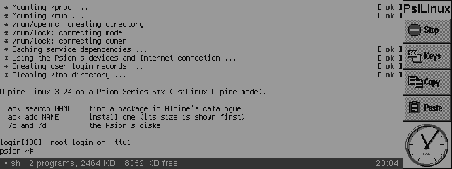

> **Status: experimental, and running on real hardware.** Alpine's
> shell-only mode runs on a real 5mx: bash and Alpine's own programs, with
> about 6.5 MB of memory still free. PsiLinux's own programs run there too.
> Most of the development and the measuring was done in an emulator of the
> 5mx and on a host test harness, so where a figure below comes from, it
> says so.

## Contents

- [Screenshots](#screenshots)
- [What it is](#what-it-is)
- [What is new about it](#what-is-new-about-it)
- [How it works](#how-it-works)
- [What runs](#what-runs)
- [Speed](#speed)
- [Installing](#installing)
- [Using it](#using-it)
- [Building and testing](#building-and-testing)
- [Documents](#documents)
- [Support](#support)
- [Credits and licences](#credits-and-licences)

## Screenshots

All from the 5mx emulator, at the Psion's own 640x240 in 16 greys. The
right-hand toolbar and the status line (the program in front, memory in use,
memory free) are PsiLinux's own.

| | |
|---|---|
| 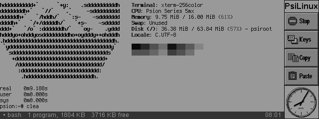 | 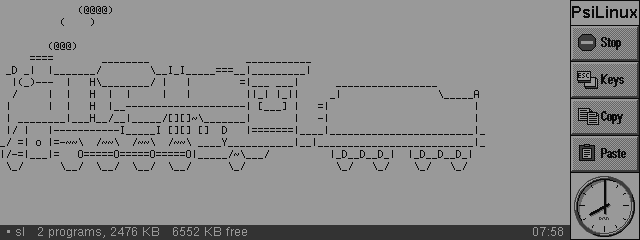 |
| **fastfetch** knows where it is. | **sl**, the steam locomotive. |
| 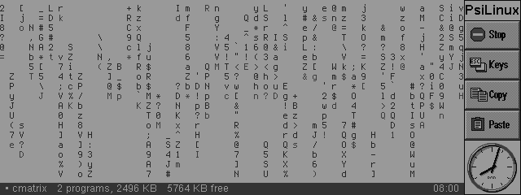 | 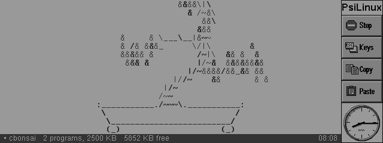 |
| **cmatrix**, in 16 greys. | **cbonsai** grows a tree. |
| 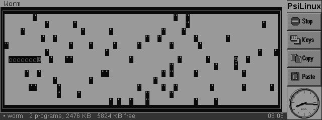 | 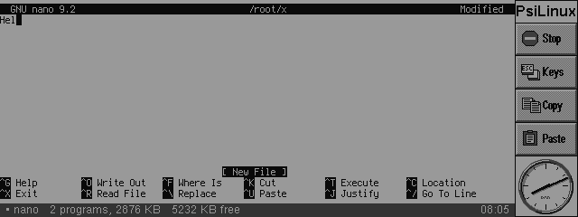 |
| **worm**, one of the BSD games. | **nano**, the standard editor. |
| 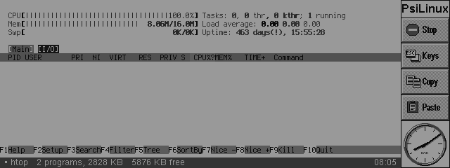 | 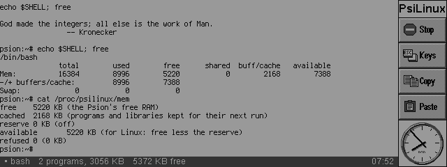 |
| **htop**'s meters. | **bash**, with what is left of 16 MB. |
| 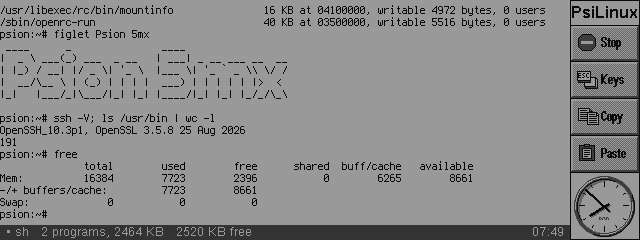 | 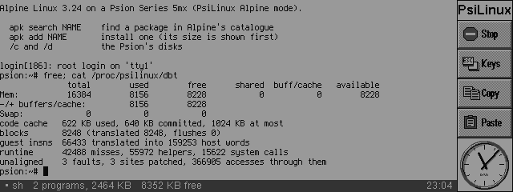 |
| **figlet**, and OpenSSH 10.3. | The translator's own figures. |

## What it is

PsiLinux is a Psion app. It opens a terminal window (PsiTerm's: xterm-256color
in 16 greys) and starts Linux in it. There are two kinds of Linux to start:

- **PsiLinux's own programs.** BusyBox (its shell, vi and about 200 commands),
  nano, Lua, MicroPython, SQLite, jq, curl and git, compiled for the 5mx's
  processor. They run natively, at the processor's full speed.
- **Alpine Linux 3.24.2.** The real distribution, built for ARMv6 with
  hardware floating point (armhf). The 5mx cannot run that code directly, so
  PsiLinux translates it into code it can run, a piece at a time, as it first
  runs. You get Alpine's boot, bash, nano, less, man, htop, ssh and a few
  games ready to use, and `apk add` for the rest of Alpine's packages.

The Psion's own disks appear as `/c` and `/d`, so Linux programs can read and
write your documents. Programs reach the Internet through the Psion's own
Internet connection.

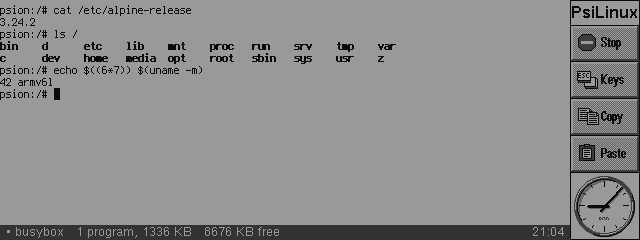

## What is new about it

A 5mx has no MMU that Linux could use, no floating point, an older ARM
than any Linux distribution supports, and an operating system that restarts
if a program makes a Linux system call. This is what made it work anyway:

- **No Linux kernel.** The runner implements Linux's system call interface
  (files, pipes, processes, signals, job control, terminals, sockets, `/proc`)
  on EPOC's own services, as WSL1 does on Windows. Every Linux thread is a
  real EPOC thread; one more thread runs the whole Linux kernel, one request
  at a time, so the kernel needs no locks.
- **No `svc` in the programs.** On EPOC, the ARM instruction Linux uses for a
  system call (`svc 0`) is an EPOC executive call, and it restarts the Psion.
  So PsiLinux's C library (musl, patched) makes every system call through
  one function, `__psi_svc`, which jumps to the runner's entry. The same
  binary still runs on real ARM Linux. The compiler wrapper disassembles every
  program it links and refuses one with a stray `svc`.
- **Translating ARMv6 and VFP for an ARMv4T with no FPU.** Alpine's programs
  are built for ARMv6 with VFP; the 5mx is an ARMv4T. PsiLinux's dynamic binary
  translator copies the ordinary instructions (about 98% of them) as they
  are, and rewrites the rest: ARMv6 media and multiply instructions,
  exclusive loads and stores, and every VFP floating-point instruction, which
  is done in software with Berkeley SoftFloat, bit-exact with a real ARM's.
  The translator is fuzzed against a real ARMv6 (qemu's ARM1176), byte for
  byte.
- **Unaligned accesses fixed up, then patched out.** ARMv6 allows unaligned
  loads and stores; the ARM710T faults on them. PsiLinux catches the fault in
  the thread's own EPOC exception handler, does the access a byte at a time,
  and then patches that one instruction so it never faults again. One Alpine
  boot took about 36,000 alignment faults before this; afterwards it took 2.
- **fork in one address space.** There is one address space, so two copies of a
  program cannot sit at the same address. PsiLinux does `fork` as uClinux
  does `vfork`, plus a snapshot: the child borrows the parent's memory, and
  when it calls `exec` or exits, the parent's memory is put back as it was.
  So `fork` then `exec` works, which is what git, `popen` and `system` need.
- **Static-pie programs that relocate themselves.** PsiLinux's own programs
  are static position-independent executables. Each is loaded at whatever
  address is free, and musl's start-up code relocates it. Alpine's programs
  use Alpine's own dynamic linker.
- **Shared libraries, once.** In Alpine mode a program or library is loaded
  once, at one address, for every process that uses it, so its translation
  serves them all. Each process's small writable part is swapped in when it
  runs.
- **The real `apk`, with signed packages.** Alpine's own package manager
  installs Alpine's own packages, checking their signatures against Alpine's
  keys as usual. Only the catalogue search runs elsewhere, because loading
  Alpine's index needs about 30 MB.
- **A real boot.** BusyBox `init` is pid 1, and OpenRC runs its `sysinit`,
  `boot` and `default` runlevels, as in a container.

## How it works

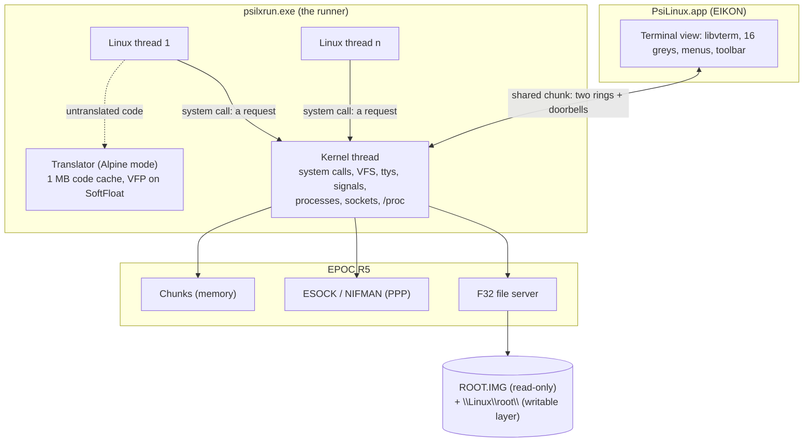

**Two processes.** `PsiLinux.app` is the window. `psilxrun.exe` is the
runner. They share a global chunk with two rings (keys in, output out) and
doorbells. The runner owns every EPOC handle (files, sockets, the file
server session), so a Linux thread holds none and can be killed at any
moment.

**System calls.** A Linux thread completes a request of the kernel thread,
then waits on its own. The kernel thread handles the call and completes it.
A call that would block (reading an empty pipe, `wait4`, `sleep`) is parked
and tried again when something changes. A system call costs about 62 µs in
the emulator, which runs about 3 times slower than a 5mx: about 20 µs on the
device, by that ratio.

**Memory.** PsiLinux cannot use the MMU to give each process its own
address space (EPOC owns it), so each
program is loaded at its own address in one address space. A program's image
is a chunk of its own. Each thread's stack has an uncommitted guard below it,
so running off the end is a SIGSEGV, not corruption. `mmap` hands out 4 KB
pages from one arena, which shrinks as its top pages are freed. Pointers
from programs are checked before the kernel uses them.

**Files.** The root is `ROOT.IMG`, a read-only image (PsiLinux's own simple
format, which keeps symbolic links and modes), under a writable layer, a
folder on the Psion's disk. Changing a file copies it up; deleting leaves a
whiteout. FAT has no links or modes, so the layer keeps them in a small file
per folder. `/c` and `/d` are the Psion's disks as they are. `/proc` and
`/dev` are the kernel's.

**The terminal.** Each terminal is a Linux tty in the kernel: line editing,
echo, signals from ^C, ^Z and ^\\, termios, the window size, the foreground
process group. The window is PsiTerm's terminal: libvterm, xterm-256color
with 256 colours mapped to 16 greys, history, pen selection and the
clipboard.

**Networking.** TCP and UDP go through ESOCK, the Psion's own Internet
connection (PPP over a dial-up modem, a phone, or a Wi-Fi modem that speaks
PPP). The dial-up starts when a program first connects, as for any Psion
program. musl asks for names at 127.0.0.53, and the kernel answers through
EPOC's resolver.

**Alpine mode.** A program without PsiLinux's ELF note goes through the
translator. Blocks of up to 48 instructions are translated when they first
run. Guest registers are the real registers and guest addresses are real
addresses, which is what lets ordinary instructions be copied unchanged.
Branches between blocks are chained; indirect branches go through a
4,096-entry hash. Only one translated thread runs guest code at a time (the
5mx has one CPU anyway), so the translator needs no locks and `ldrex`/`strex`
need no monitor.


The full design is in [docs/DESIGN.md](docs/DESIGN.md), and the reasons for
each choice, with what else was tried, are in
[docs/DECISIONS.md](docs/DECISIONS.md).

## What runs

### PsiLinux's own programs

| Program | Version | Notes |
|---|---|---|
| BusyBox | 1.36.1 | 204 commands, built for no MMU. The shell is hush (ash needs an MMU): job control, functions, `$(…)`, here-documents, line editing |
| nano | 8.2 | |
| Lua | 5.4.7 | |
| MicroPython | 1.23.0 | no FFI, threads or SSL |
| SQLite | 3.46.1 | |
| jq | 1.7.1 | |
| curl | 8.10.1 | HTTPS with Mbed TLS 3.6.2 |
| wget | BusyBox's | with its own TLS |
| git | 2.47.0 | https through libcurl. On the host harness: init, add, commit, log, diff, status and `clone` over https. In the emulator, `git --version` runs; longer git sessions run into the emulator's card fault (below) and have not been seen to finish there |

### Alpine packages

The Alpine root comes with bash (the shell), nano, less, mandoc (`man`),
htop, ncdu, tree, jq, bc and openssh-client (ssh, scp), and for fun fortune,
figlet, sl, cmatrix, micro-tetris, bsd-games, cbonsai, nyancat and
fastfetch: each chosen because it runs, draws correctly and fits in memory
beside bash. [docs/ALPINE.md](docs/ALPINE.md) has the full table, with what
was left out and why (vim, git's https, curl, tmux, rsync...).

The table below is 0.20's: installed with the Psion's `apk` from Alpine's
real packages, and run on the host harness (qemu as an ARMv4T, like the
5mx). Memory is the most the program used, including the libraries it
mapped. The emulator's 5mx had about 8.3 MB free after Alpine booted with
BusyBox sh, and about 9 MB in shell-only mode; with bash (0.21), about
7.4 MB is available after a full boot.

**On a real 5mx** (0.21, from the runner's log), shell-only mode with bash
left about 6.5 MB free, which is the room the table's "Fits" column is about.
A full boot with bash is too tight there: free memory fell to about 0.7 MB
during OpenRC's start-up. Shell-only is the mode to use on a 5mx for now.

| Package | Runs | Download / on disk | Memory | Fits on a 5mx? |
|---|---|---|---|---|
| nano | yes | 0.3 / 0.7 MB | 1.3 MB | yes |
| less | yes | 0.3 / 0.6 MB | 1.3 MB | yes |
| htop | yes | 0.4 / 1.0 MB | 1.3 MB | yes |
| lua5.4 | yes | 0.5 / 1.0 MB | 1.5 MB | yes |
| sqlite | yes | 1.3 / 2.5 MB | 3.2 MB | yes |
| git | yes | 5.8 / 12.1 MB | 4.7 MB | yes (init, add, commit, log) |
| vim | yes | 10.2 / 31.1 MB | 5.2 MB | yes, but its runtime files need 31 MB of disk |
| links | yes | 1.3 / 2.8 MB | 7.6 MB | only just, in shell-only mode |
| curl | yes (HTTP and HTTPS) | 2.2 / 4.8 MB | 9.5 MB | probably not: 13 libraries |
| python3 | yes | 10.1 / 26.5 MB | 11.1 MB | no |

`apk add` tells you before it downloads anything whether a package fits on
the disk and is likely to fit in memory.

### What does not work, or works differently

- **Memory is the limit.** EPOC owns the 5mx's MMU, so PsiLinux has no
  swap and no demand paging: a
  program's whole image and libraries are in RAM while it runs.
- **fork:** the child runs first, until it calls `exec` or exits; then the
  parent goes on. Pipelines, `$(…)`, `system()` and git work. A parent and
  child that must both keep running (a server that forks per connection, or
  a background subshell `( … ) &`) cannot.
- **One CPU:** threads take turns. Alpine programs whose threads must run at
  the same time have not been tested.
- **Signals:** a handler runs when the thread next makes a system call. A
  program spinning in a loop with no calls gets its ^C late; a second ^C
  within 5 s ends it.
- **No kernel underneath:** no kernel modules, no `/sys` devices, no
  hardware services. `mount` only records a mount. `uname -m` says armv6l.
- **Floating point in Alpine programs is slow:** every VFP instruction is
  done in software. PsiLinux's own programs use the compiler's soft float,
  which is quicker.
- **Not supported:** Thumb and NEON code (Alpine's armhf uses neither), VFPv3.
- **The network** is the Psion's PPP connection only. PsiTerm's other route,
  a Hayes modem carrying one raw TCP connection, cannot carry Linux's
  sockets.

## Speed

**The emulator against a real 5mx.** The same busy loop took 984 ms in the
emulator and 328 ms on a real 5mx, so the emulator runs about 3 times slower.
The figures below are from the emulator unless they say otherwise.

**Unaligned accesses on a real 5mx.** Alpine's code was built for a newer
ARM that allows unaligned loads and stores; the 5mx's ARM710T faults on
them. PsiLinux fixes each one up and then patches the instruction that caused
it, so the next time it goes straight to the fix-up. On a real 5mx that left
3 to 10 actual faults a session; the rest (from 1,600 to 100,000 accesses a
session, and about 395,000 in the full boot) went through the patched sites. In the emulator, before patching, a
boot took about 36,000 faults.

**Native programs** (PsiLinux 0.10, the emulator, timed with a 1-second
clock): starting a program under 1 s, `ls /bin` 1 s, Lua `fib(20)` 1 s,
SQLite inserting 1,000 rows 1 s, jq 2 s, gzip of 100 KB 2 s, a MicroPython
100,000-turn loop 10 s.

**Alpine against native.** The same BusyBox commands: PsiLinux's own
(native) and Alpine's (translated), on a file of 3,000 lines, second run, in
the emulator with the ARM710T's alignment faults:

| Command | Native | Alpine | Alpine's first run |
|---|---|---|---|
| a shell loop of 500 turns | 2.4 s | 2.3 s (1.0 times) | 2.5 s |
| md5sum | 0.35 s | 0.47 s (1.3 times) | 0.50 s |
| grep -c | 1.5 s | 2.6 s (1.7 times) | 2.7 s |
| `ls -l /etc` | 0.17 s | 0.32 s (1.9 times) | 0.41 s |
| sort | 2.4 s | 12.0 s (5.1 times) | 21.0 s |
| awk, 3,000 square roots | 1.7 s | 10.1 s (5.9 times) | 10.1 s |

Integer code runs at nearly native speed. Floating point is slowest, and
`sort` pays for its many indirect calls.

**Booting Alpine** (BusyBox init and OpenRC to the login prompt) took about
136 s in the emulator with BusyBox sh. On a real 5mx with 0.21's bash, the
boot ran OpenRC's services but ran short of memory (above), so a timed boot to
the login prompt on the device is still to come. The boot translated 8,047 blocks (605 KB
of code) without filling the 1 MB code cache.

## Installing

You need a Psion Series 5mx (EPOC R5) and, for the Linux programs, a
CompactFlash card with room: about 12 MB for PsiLinux's programs, about 26 MB
for Alpine (with its preinstalled programs), plus what you install.

Download the installers from the
[Releases](https://github.com/danieledge/psilinux/releases) page:

| Installer | Install on | What |
|---|---|---|
| `PsiLinux.sis` | C: or D: | the app and the runner (about 400 KB) |
| `PsiLinux-root.sis`, `PsiLinux-root-2.sis` | the Linux disk (D:) | PsiLinux's own programs: `\Linux\ROOT.IMG` and its parts (11.8 MB, of which git is 6 MB) |
| `PsiLinux-alpine-root.sis`, `-2.sis` … `-5.sis` | the Linux disk (D:) | Alpine Linux 3.24.2 with bash and the programs above: `\Linux\Alpine\ROOT.IMG` and its parts (25.3 MB) |

The roots come in several installers of at most 6.3 MB, because the Psion's
installer cannot open a very large `.sis`, whatever is in it (0.21's 25.9 MB
one said "Not enough memory"). Install them all, the
first one first, on the same disk.

Install `PsiLinux.sis` and at least one root, in the usual way (copy the
files to the Psion, then open them, or use PsiWin). If a `.sis` file sits on
the card itself, the card needs room for it and for what it installs.

Open **PsiLinux** from Extras. The Linux disk is D: unless Tools > Linux
disk… says otherwise. Your changes to Linux are kept beside the image, in
`\Linux\root\` (or `\Linux\Alpine\root\`), and survive an update of the
image.

To remove it all: Control panel > Add/remove, then delete the `\Linux\`
folder.

## Using it

### Starting

Tools > Preferences… (Shift+Ctrl+K) > **Start** chooses what File > Start
Linux (Shift+Ctrl+N) runs:

- **Alpine Linux** boots as Alpine does: BusyBox init, then OpenRC, then a
  root login to bash on the window. `poweroff` or File > End Linux ends it.
- **Alpine Linux, shell only** goes straight to bash. It is quicker and
  leaves more memory free.
- **PsiLinux** runs PsiLinux's own programs.

If Alpine is chosen but its root is not installed, PsiLinux says so and starts
its own programs instead. File > End Linux (Shift+Ctrl+D) always stops Linux.

Preferences > General > **Keep memory for other programs** (off as standard)
keeps 512 KB, 1 MB or 2 MB free for the Psion's own programs: Linux programs
get "out of memory" first, and Linux goes on. `cat /proc/psilinux/mem` shows
the figures.

### Keys

| Key | Does |
|---|---|
| Shift+Ctrl+I | types `\|` (the 5mx keyboard has no key for it) |
| Keys > Symbols | `\|`, `` ` `` and `~` |
| Ctrl+letter | goes to Linux, as on any terminal (^C, ^D, ^Z…) |
| Shift+Ctrl+letter | the app's own commands |
| Shift+Ctrl+H | Help |

### Packages with apk

```
apk update                 the catalogue's size and date
apk search [-v] [-d] TEXT  find packages (-d: in descriptions too)
apk info [-a] NAME         a package's description and sizes
apk add [-s] NAME…         install (-s: only say what it would do)
apk del NAME…              remove
apk upgrade [-s]           newer versions of what is installed
apk list [-I]              what is installed (-I) or available
```

Alpine's own apk needs about 30 MB of memory to load the full catalogue. A
5mx has about 9 MB free. So a small helper on your PC, `psiapk`, holds the
catalogue, answers searches and works out what an install needs. The Psion
then downloads Alpine's own signed packages, and the real apk installs them
from the files, checking their signatures against Alpine's keys. The helper
never builds or changes a package, and needs no trust beyond that.

To set it up:

1. On a PC on the same network, run PsiProxy (from
   [PsiProxy](https://github.com/danieledge/psiproxy)) with the
   helper, as [docs/BUILDING.md](docs/BUILDING.md) describes.
2. Turn on the proxy in the Psion's Connection settings (PsiTerm, PsiMail or
   PsiWeb) with the PC's address: apk uses it. Or, in Alpine on the Psion,
   put the address in `/etc/psilinux/apk.conf`:
   `APK_SERVER=http://<your PC>:8081` (`nano /etc/psilinux/apk.conf`).
3. `apk update`.

`APK_DIRECT=1 apk add …` downloads the packages from Alpine's mirror over
plain http instead (apk still checks their signatures); the catalogue still
comes from the helper.

### Making memory go further

- Use **shell only** mode when you do not need the boot.
- Close other Psion apps before installing a big package: apk itself needs
  about 7 MB while it works.
- `free` and the status line show free memory. `cat /proc/psilinux/dbt`
  shows the translator's figures, and `cat /proc/psilinux/images` the
  programs and libraries that processes share.
- A program runs faster the second time: its translation stays in the 1 MB
  code cache while there is room.

### When something goes wrong

The runner's log is `\Linux\PsiLinux.log` (`\Linux\Alpine\PsiLinux.log` in
Alpine mode). In Alpine mode it has a line every 30 s with free memory and
the translator's figures. A file named `BOOTLOG` in `\Linux\Alpine\` adds a
line for each program started, which shows where a boot stopped.

If you try PsiLinux on a real 5mx, [docs/TEST-5MX.md](docs/TEST-5MX.md) is a
test sheet, and reports are very welcome as issues: back up C: and D: first,
because the Psion may restart in the middle of a test.

## Building and testing

PsiLinux builds in Docker. It carries the suite's shared code,
[psion-core](https://github.com/danieledge/psion-core), as the submodule
`core/` (clone with `--recurse-submodules`), and takes its terminal from a
[psiterm](https://github.com/danieledge/psiterm) checkout beside this one:

```sh
core/tools/docker/psibuild "bash build.sh sis"     # the app and the runner -> dist/PsiLinux.sis
tools/lxbuild toolchain                            # GCC 14 + patched musl, once
tools/lxbuild "rootfs/build-rootfs.sh"             # PsiLinux's own root
alpine/build-root.sh                               # the Alpine root
tools/lxbuild "tests/run-host.sh"                  # the test suites on the host harness
tools/lxbuild "tests/run-alpine.sh"                # Alpine mode: shell tests under sh and bash, bash in a terminal, the memory reserve
tests/run-ssh.sh                                   # ssh against a throwaway sshd in docker (run on the PC): key, password, host key question
```

The kernel (`runtime/`) is portable C. Built with a different back end, it
is **psihost**, an ARM Linux program that runs the same kernel under
`qemu-arm` on a PC, so the test suites run in seconds. The translator is
tested against a real ARMv6: random instruction sequences run natively under
qemu's ARM1176 and translated under psihost as an ARMv4T, and their
registers, flags, VFP registers and memory must agree byte for byte. 30 seeds
(9,000 cases) agree, and 12 more with every instruction class forced through
the interpreter.

Everything is in [docs/BUILDING.md](docs/BUILDING.md): the folder layout, the
SDK, the emulator, the package helper and making a release.

| Folder | What |
|---|---|
| `app/` | PsiLinux.app: the window, menus, Help |
| `runner/` | psilxrun.exe's EPOC side: threads, files, sockets, exceptions |
| `runtime/` | the kernel and the translator, portable C (also built as psihost) |
| `common/` | the chunk the app and the runner share |
| `toolchain/` | the toolchain build, the musl patch, the atomics |
| `rootfs/`, `ports/` | PsiLinux's own root: BusyBox and the other programs |
| `alpine/` | the Alpine root build, PsiLinux's files in it, and the apk helper |
| `tests/` | the test suites, and the translator's fuzzer |
| `tools/` | lxbuild, mkroot.py, mkicons.py, the emulator scripts |
| `probe/` | LxProbe, the hardware probe (a test program, never released) |
| `pkg/` | the installers' `.pkg` files |

## Documents

- [docs/DESIGN.md](docs/DESIGN.md): how it works, and what EPOC R5 allows
  (measured).
- [docs/DECISIONS.md](docs/DECISIONS.md): every choice, the alternatives, and
  why.
- [docs/ALPINE.md](docs/ALPINE.md): Alpine mode in detail.
- [docs/BUILDING.md](docs/BUILDING.md): building, testing and releasing.
- [docs/TEST-5MX.md](docs/TEST-5MX.md): a test sheet for a real 5mx.
- [SOURCES.md](SOURCES.md): the Linux programs in the images, and their
  source.

## Support

If PsiLinux puts a smile on your Psion and you'd like to say thanks,
you can [buy me a coffee](https://buymeacoffee.com/danedge).

## Credits and licences

PsiLinux is by Dan Edge, part of the family of Psion apps that includes
[PsiTerm, PsiMail and PsiWeb](https://github.com/danieledge/psiterm).

It stands on the work of many others: [musl](https://musl.libc.org/),
[BusyBox](https://busybox.net/), [Alpine Linux](https://alpinelinux.org/),
[Berkeley SoftFloat](http://www.jhauser.us/arithmetic/SoftFloat.html) (John
R. Hauser), [libvterm](https://www.leonerd.org.uk/code/libvterm/),
[musl-cross-make](https://github.com/richfelker/musl-cross-make), the
[EPOC R5 SDK for Linux](https://github.com/static-void/psion_cpp_sdk_linux),
[psionEmulators](https://github.com/joehaines/psionEmulators), and the
authors of every program in the images. The ideas owe a lot to WSL1 and
uClinux.

PsiLinux's own code is under the [MIT licence](LICENSE).
[THIRD-PARTY.md](THIRD-PARTY.md) lists the code compiled into PsiLinux's
programs (SoftFloat is BSD; there is no GPL code in them). The Linux
programs in the root images keep their own licences, several of them GPL;
[SOURCES.md](SOURCES.md) lists each one and where to get its source.

Psion and EPOC are trademarks of their owners. This project has no
connection with them.
